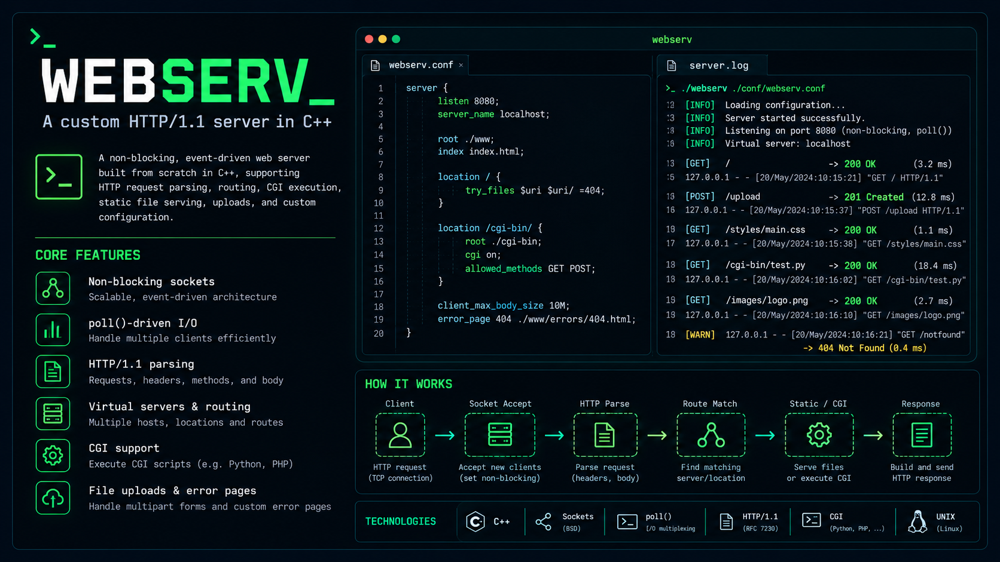
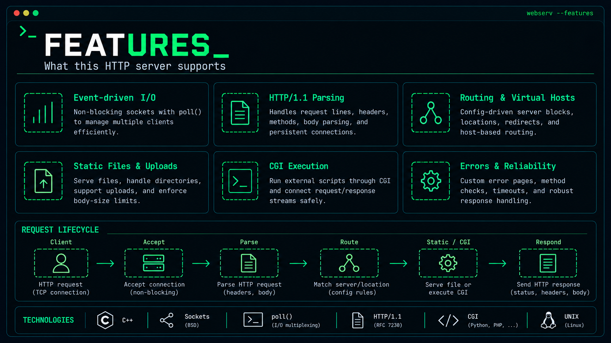

*This project has been created as part of the 42 curriculum by ipavlov, agerokhina.*

# Webserv



**An event-driven HTTP server built from scratch in C++.**

`C++17` · `HTTP/1.1` · `Sockets` · `poll()` · `CGI` · `Unix / POSIX`

## Description

What actually happens between a browser sending a request and a server returning a response?

We built **Webserv** to answer that question by implementing an HTTP server ourselves. Rather than using an existing web-server framework, we worked directly with TCP sockets, HTTP message parsing, file descriptors, configuration rules, files, and processes.

The central challenge was to support multiple connections without letting a slow client or CGI process stop the rest of the server. Our solution uses non-blocking I/O and a `poll()`-driven event loop, with individual client state maintained across reads and writes.

This project was developed for the **42 / Codam Amsterdam** curriculum and successfully evaluated. It is written in C++17, which is permitted for our Codam project.

## Features



| Area | What we implemented |
| --- | --- |
| **Networking** | Non-blocking TCP sockets, `poll()`-based I/O multiplexing, multiple listening ports, and concurrent clients |
| **HTTP** | HTTP/1.0 and HTTP/1.1 request parsing, `GET`, `POST`, `DELETE`, persistent connections, `Content-Length`, and chunked request bodies |
| **Routing** | Configuration-driven server and location blocks, virtual hosts via `Host`, index files, and redirects |
| **Static content** | File serving, optional directory listing, and custom error pages |
| **Uploads** | File uploads, `multipart/form-data` parsing, configurable upload destinations, and request-body size limits |
| **CGI** | CGI execution with `fork()`, `execve()`, pipes, request environment variables, and non-blocking communication |
| **Reliability** | Request validation, method restrictions, timeouts, process cleanup, and filesystem path checks |

## How it works

```text
                 +---------------------+
                 |   Client / Browser  |
                 +----------+----------+
                            |
                       TCP request
                            |
                 +----------v----------+
                 |   Listening socket  |
                 |     accept()        |
                 +----------+----------+
                            |
                 +----------v----------+
                 |   poll() event loop |
                 |  non-blocking I/O   |
                 +----------+----------+
                            |
                 +----------v----------+
                 |    HTTP parser      |
                 | headers + body      |
                 +----------+----------+
                            |
                 +----------v----------+
                 |  Config + routing   |
                 | host / location     |
                 +----------+----------+
                            |
                  +---------+---------+
                  |                   |
          +-------v-------+   +-------v-------+
          | Static files  |   | CGI process   |
          | / uploads     |   | fork / execve |
          +-------+-------+   +-------+-------+
                  |                   |
                  +---------+---------+
                            |
                 +----------v----------+
                 |   HTTP response     |
                 | status + headers    |
                 | + body              |
                 +---------------------+
```

The server tracks each connected client's progress instead of assuming that an entire request or response will fit into a single read or write. CGI communication is integrated into the event loop through pipes, so the server can continue serving other connections while a script is running.

## Getting started

### Requirements

- A C++17-capable compiler available as `c++`
- `make`
- A POSIX-compatible environment with sockets, `poll()`, pipes, and process system calls
- An installed interpreter for any configured CGI scripts (the default configuration uses Python 3 at `/usr/bin/python3`)

### Build

From the project root:

```bash
make
```

The Makefile uses `-Wall -Wextra -Werror -std=c++17`.

### Run

Start the server with the included configuration:

```bash
./webserv
```

Or supply a configuration file:

```bash
./webserv config/default.conf
```

With the supplied configuration, the main server listens on **port 8080** and an additional server listens on **port 8081**.

Open `http://localhost:8080/` in a browser or try:

```bash
curl -i http://localhost:8080/
```

### Makefile targets

```bash
make          # Build the server
make test     # Build and run the included tests
make clean    # Remove build objects and dependency files
make fclean   # Remove generated objects and binaries
make re       # Rebuild from scratch
```

## Configuration

We use a small configuration language inspired by NGINX. It supports multiple `server` blocks and location-specific behavior.

A simplified example:

```nginx
server {
    listen 8080;
    server_name localhost;

    root ./site/www;
    index index.html;
    client_max_body_size 131072;
    error_page 404 /errors/404.html;

    location / {
        allow_methods GET;
        autoindex off;
    }

    location /upload {
        root ./site/www/upload;
        allow_methods GET POST;
        upload_store ./site/www/uploads;
        index index.html;
    }

    location /cgi-bin {
        root ./site/www/cgi-bin;
        allow_methods GET POST;
        cgi_extension .py;
        cgi_path /usr/bin/python3;
        client_max_body_size 100;
    }

    location /legacy {
        return 301 /redirected.html;
    }
}
```

The actual default configuration is in [`config/default.conf`](config/default.conf). It also defines routes for assets, documentation, uploaded files, and more.

Common directives include `listen`, `server_name`, `root`, `index`, `allow_methods`, `autoindex`, `client_max_body_size`, `error_page`, `upload_store`, `cgi_extension`, `cgi_path`, and `return`.

> The configured upload directory must exist before using uploads. CGI interpreters must be installed at the paths set in the configuration.

## CGI: the interesting part

CGI was one of the more challenging pieces of the project because it brings networking and process management together.

For a matching CGI request, Webserv resolves the script and interpreter, creates pipes, forks a child, prepares the CGI environment, and executes the interpreter with `execve()`. The parent process forwards the request body to the child and reads its output through non-blocking pipes before constructing the HTTP response.

We also had to think about what happens when a client disconnects, a script takes too long, or a pipe reaches EOF. Correct cleanup of file descriptors and child processes is part of making the server reliable.

## Testing

Run the project's test executable with:

```bash
make test
```

We tested both individual components and full request flows, including fragmented requests, chunked bodies, keep-alive connections, virtual hosts, uploads, malformed headers, CGI execution, simultaneous clients, and connection cleanup.

A few useful manual checks:

```bash
# Basic response
curl -i http://localhost:8080/

# Inspect the second configured port
curl -i http://localhost:8081/

# Send a request with an explicit Host header
curl -i -H 'Host: localhost' http://localhost:8080/

# Confirm an unsupported method is rejected for the root route
curl -i -X DELETE http://localhost:8080/
```

The `tests/` directory contains the project's C++ test code and fixtures.

## Project layout

```text
webserv/
├── main.cpp
├── Makefile
├── code/
│   ├── ServerManager.cpp       # Socket lifecycle and event loop
│   ├── ServerManagerCGI.cpp    # CGI process and pipe handling
│   ├── HTTPRequestParser.cpp   # HTTP request parsing
│   ├── HTTPResponseBuild.cpp   # HTTP response construction
│   ├── ConfigParser.cpp        # Configuration parsing
│   └── hpp/                    # Header files
├── config/
│   └── default.conf
├── site/                       # Demo content and CGI scripts
├── tests/                      # Test code and fixtures
└── assets/                     # README images (add this folder)
```

## What we learned

This project gave us a much clearer picture of what a web server does behind the scenes. Some of the hardest problems were not about producing a correct response in the happy case, but about handling all the situations around it: partial I/O, persistent connections, CGI processes, disconnected clients, and cleanup after errors.

Working through those cases helped us become more comfortable with **system calls, event-driven architecture, HTTP, and debugging behavior that only appears under specific timing or concurrency conditions**.

We also learned the value of testing assumptions. A server can look perfectly fine in a browser and still behave incorrectly when a request arrives in pieces or a client goes away halfway through an operation.

## Resources

- [42 Webserv subject](https://github.com/42School) — project requirements and scope (see the subject distributed with the course)
- [RFC 9110: HTTP Semantics](https://www.rfc-editor.org/rfc/rfc9110) — methods, status codes, and headers
- [RFC 9112: HTTP/1.1](https://www.rfc-editor.org/rfc/rfc9112) — HTTP message framing and connections
- [RFC 3875: CGI/1.1](https://www.rfc-editor.org/rfc/rfc3875) — CGI environment and protocol
- [NGINX documentation](https://nginx.org/en/docs/) — configuration concepts and server behavior
- [Linux man-pages](https://man7.org/linux/man-pages/) — sockets, `poll()`, `fork()`, pipes, `dup2()`, `execve()`, and related APIs
- [cppreference](https://en.cppreference.com/) — C++ language and library reference

### AI-assisted learning and review

We used AI as a supporting tool for explaining unfamiliar concepts, discussing failure scenarios, reviewing code and configuration, suggesting tests, and improving documentation. Suggestions were checked against the project requirements and our own implementation and tests rather than accepted without review. The implementation and project decisions remain our responsibility.

The README graphics were also AI-generated and are **illustrations**, not screenshots of real server output.

## Authors

Developed together at **Codam Amsterdam (42 Network)**:

- **Ivan Pavlov** — 42 login: `ipavlov` · GitHub: [@12Ivan03](https://github.com/12Ivan03)
- **Alina Erokhina** — 42 login: `agerokhina` · GitHub: [@agerokhina](https://github.com/agerokhina)

---

*Built to understand what happens beneath the HTTP response.*
